# Set and rep flow: state diagram

The diagram is derived from `app.js` v8.14 (`enterWorkout`, `processFrame`, `finishPending`, `saveSet`, `showToast`, `fbCut`) and `reps.js` (`createPicker`, `relock`, `plausibleSet`).
- There is no explicit state variable in the app. The state is implied by `lockEx` / `autoEx` / `manualEx`, `currentReps()`, `lastRepWall` and `setToast`.
- All counters (one per exercise) run on every frame, in every state.

```mermaid
stateDiagram-v2
    [*] --> Home
    Home --> StartScreen: tap Start økt (getUserMedia in the tap)
    StartScreen --> Idle: camera + model ready (fbStart: feedback recorder starts)
    note right of Idle
      reps = 0, lockEx = null
      every frame: camGate → ALL counters.update →
      recognizer → picker (needs 1.5 s hold, score ≥ 0.3, conf ≥ 0.25)
      feedback: trimIdle(30 s) every 2 s while no counter is tentative
    end note
    Idle --> Detected: picker.current = X (autoEx = X, chip shows X)
    Detected --> Detected: picker switches to Y (only while not locked)
    Detected --> Counting: counters[curEx].reps ≥ 1 (lastRepWall = now)
    Idle --> Counting: manualEx chosen and a rep is counted
    Counting --> Locked: reps ≥ 2 → lockEx = curEx
    Locked --> Locked: rep counted (lastRepWall = now)
    Locked --> Locked: relock(), another counter has ≥ max(4, lock) reps, its score is 1.5× higher → lockEx = Y
    Counting --> CamPaused: phone moves (camGate)
    Locked --> CamPaused: phone moves
    CamPaused --> Counting: phone still again (frames ignored meanwhile)
    Counting --> Pending: no new rep for AUTOSAVE_MS (9 s, wall clock)
    Locked --> Pending: no new rep for AUTOSAVE_MS
    Locked --> Saved: tap Lagre sett (saveSet)
    Pending --> Saved: finishPending, last relock(atSave); reps ≥ 2 AND (manual OR plausibleSet(repTimes))
    Pending --> Idle: reps < 2 or not plausible → that counter is reset, set dropped
    Saved --> Toast: store.addSet; fbCut(pred, setTs) cuts the clip + landmarks + repTimes; resetCounters (lockEx = null)
    note right of Saved
      picker and recognizer are NOT reset,
      so autoEx stays the last exercise
    end note
    Toast --> Idle: toast stays ≥ 60 s and until the next set has a rep (max 15 min)
    Toast --> Edit: Endre → openEdit (fbLabel corrected)
    Toast --> Idle: Angre → deleteSet + fbLabel delete
    Edit --> Idle: save/delete
    Idle --> MissedCut: tap «Telte ikke» (fbMiss) → fbCut(label missed)
    MissedCut --> Idle
    Idle --> Home: Avslutt økt / ✕ / 10 min idle with camera on (IDLE_END_MS) → endSession → Strava queue
```

## Logic gaps that could explain false sets during rest or rigging

These are listed only, not fixed.

1. **There is no rest state.** The app only knows `reps == 0` vs `reps > 0`. Every counter keeps running between sets, so loading plates, walking up to the phone or stretching can start a "set" at any moment. Nothing like "person left / came back" or "set-up pose held" gates the start of a set.
2. **The picker is sticky.** `createPicker` never returns to `null`: when the guess becomes unclear, `cur` keeps the last exercise. After a set, `autoEx` stays on that exercise, and since `saveSet` does not reset `picker` or `recognizer`, its counter counts rigging motion straight away. This is the pattern behind false «knebøy ×2 @100» and «curl ×2» between sets.
3. **The lock threshold is low.** `MIN_AUTO_REPS = 2`, and `lockEx` is set at the 2nd rep of whatever is current. Two plate-loading bends are enough. Relock only helps if a real set follows with ≥ 4 reps.
4. **`plausibleSet` only checks timing.** It rejects 2–5 reps with long or irregular gaps, but regular 2–3 s rigging motions pass. It does not check amplitude consistency, rep duration, body orientation (standing vs the exercise's posture) or distance to the camera.
5. **Close-up and partial-body frames are not gated.** `camGate` only reacts to phone motion. A person sitting or standing close to the phone (ztyb: false «roing») produces large normalized joint movement, and nothing rejects frames where the body fills the frame or the legs/hips are cut off for exercises that need them.
6. **Background counters inherit reps.** Non-current counters keep counting and are only forgotten after 9 s without a rep. If the picker switches to exercise Y while Y's counter already holds 1–2 rigging reps, `currentReps()` jumps instantly and the set can lock and save on stale motion.
7. **Two different clocks.** Autosave uses wall time (`Date.now() - lastRepWall`), while the counters, forget and relock use frame time (`lastFrameT`). When frames stall (slow device, thermal throttling, a hidden tab that resumes), autosave can fire mid-set or a gap can be stretched. That splits real sets or lets two rigging bursts merge into one set.
8. **The toast extends nothing.** After a save, nothing enforces a minimum rest before the next set can start. A rep can be counted milliseconds after `resetCounters`, for example the lifter racking the bar or standing up after the last rep, which seeds the next false set.
9. **The feedback clip cut follows the same wrong boundaries.** `fbCut` happens only on save or «Telte ikke», and `trimIdle` keeps only the last 30 s when no counter is tentative. Long rigging that forms a false set is uploaded as a "set", while the real set that follows may get trimmed context.
